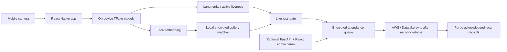
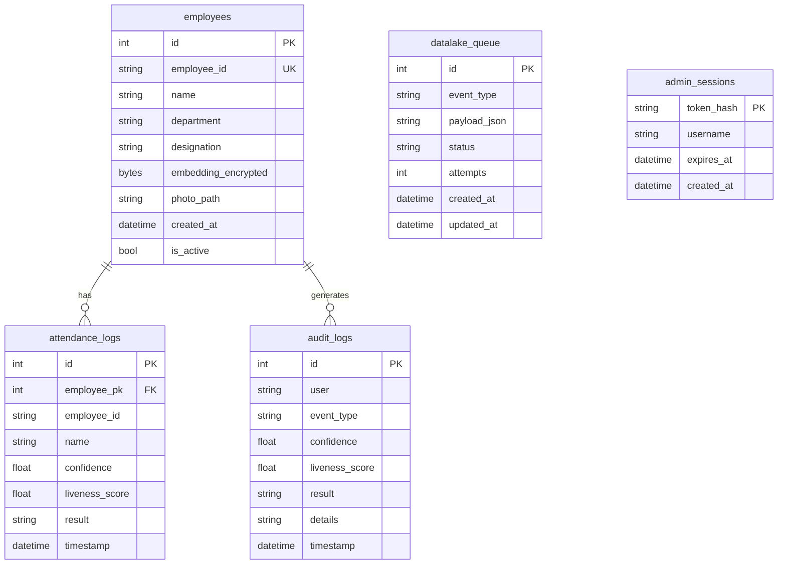

# Architecture

## System Overview

The judge-facing architecture is mobile-first. The React Native app performs camera capture, liveness, face embedding, matching, local queueing, and sync/purge on device. The existing FastAPI and React dashboard remain as an optional admin/reference environment for exports, local demonstrations, and API inspection.

## Offline Design

The inference path uses only local files and mobile CPU/NNAPI/Core ML-backed execution. Registration, recognition, liveness, and attendance queueing continue to work with zero network connectivity. Datalake integration is queue-based: events are stored locally first and synchronized only after connectivity returns. Acknowledged events are purged from the device.

## Modules

- `mobile`: React Native Android/iOS prototype and mandatory hackathon app.
- `mobile/src/engine`: on-device inference contracts, matcher, and liveness challenge evaluator.
- `mobile/src/services`: encrypted local gallery, attendance queue, sync, and purge services.
- `backend/app/api`: optional FastAPI routes for admin/local demo workflows.
- `backend/app/core`: settings and application bootstrap.
- `backend/app/db`: SQLAlchemy session and migrations-lite initialization.
- `backend/app/models`: database tables.
- `backend/app/schemas`: Pydantic request and response contracts.
- `backend/app/services`: face recognition, liveness, audit, metrics, export, benchmark.
- `backend/app/security`: password hashing, sessions, encryption helpers.
- `backend/app/integrations`: Datalake 3.0 queue, REST adapter, local adapter.
- `ai`: reusable computer vision engines.
- `frontend`: React edge operator console.

## Data Flow

1. Field operator opens the React Native app with no network dependency.
2. Enrollment captures a camera frame, validates quality, generates an on-device embedding, and stores the encrypted template locally.
3. Authentication captures a short frame sequence for blink, head-turn, and smile checks.
4. The app computes the face embedding locally and compares it with the encrypted gallery.
5. Attendance is queued only when the identity match and liveness threshold pass.
6. When connectivity returns, the app syncs queued events to AWS/Datalake.
7. Events acknowledged by the server are purged from local encrypted storage.

## Database Schema

## Security Model

- Admin login uses PBKDF2 password hashing.
- API sessions are opaque bearer tokens stored as SHA-256 hashes.
- Embeddings are encrypted at rest with a local Fernet key derived from `APP_SECRET_KEY`.
- All recognition, spoofing, export, and sync actions are audit logged.
- The app is intentionally offline-first; external sync is explicit and queued.
