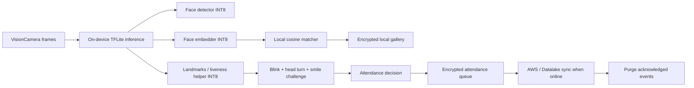

# Mobile Prototype

## Submission Positioning

FaceGuard Edge is now presented as a React Native mobile-first prototype with an optional local admin/backend dashboard. The mobile app is the mandatory Android/iOS deliverable; the existing FastAPI and React web modules remain useful for local admin demos, audit export, and evaluator inspection.

## Mobile Architecture

## Key Files

- `mobile/App.tsx`: judge-facing mobile workflow with Enroll, Recognize, and Sync tabs.
- `mobile/src/engine/faceEngine.ts`: offline embedding and recognition contract. The simulator path is deterministic; device builds should wire the same contract to `react-native-fast-tflite`.
- `mobile/src/engine/livenessChallenge.ts`: active liveness evaluator for blink, left turn, right turn, and smile.
- `mobile/src/services/localStore.ts`: encrypted employee gallery and attendance queue.
- `mobile/src/services/attendanceService.ts`: liveness-gated offline attendance creation.
- `mobile/src/services/syncService.ts`: connectivity-aware sync and purge-after-acknowledgement logic.

## Model Strategy

Use three quantized models packaged inside the app:

| Component | Candidate | Target size | Purpose |
| --- | --- | ---: | --- |
| Face detector | BlazeFace / SCRFD-500M INT8 | 1-3 MB | Fast face crop on mid-range devices |
| Face embedder | MobileFaceNet / ArcFace mobile INT8 | 4-8 MB | 128D/192D identity template |
| Landmarks | lightweight face landmark INT8 | 1-4 MB | Eye openness, yaw, smile |

Total target: below 15 MB, leaving margin under the 20 MB requirement.

## Accuracy Plan

- Train or fine-tune the embedder with balanced Indian demographic coverage across age, gender presentation, skin tone, headwear, and outdoor lighting.
- Use triplet/ArcFace loss and hard negative mining for highway-site lookalike conditions.
- Calibrate the cosine threshold per model with FAR/FRR curves, targeting greater than 95% top-1 recognition in the enrolled gallery.
- Add quality gates for blur, low light, overexposure, and partial face crops before enrollment.

## Liveness Plan

The mobile app uses active liveness because it is compact, explainable, and works offline:

1. Ask the user to blink.
2. Ask the user to turn left or right.
3. Ask the user to smile or return to center.
4. Reject if texture/sharpness or exposure quality is poor.
5. Queue attendance only when liveness score is at least 0.72.

This blocks static photo attacks and raises the cost of screen replay attacks without adding a large anti-spoof model.

## Sync and Purge

The mobile queue is append-only while offline. When connectivity returns:

1. The app posts pending events to the configured AWS/Datalake endpoint.
2. Events receiving a successful server response are removed from encrypted local storage.
3. Failed events remain in the queue with an incremented attempt count and last error.
4. The user can retry without duplicate purging because event IDs are stable.

## Demo Checklist

- Disable network before the demo.
- Enroll one employee.
- Run liveness plus recognition.
- Show attendance is queued locally.
- Re-enable network.
- Sync to a mock or staging Datalake endpoint.
- Show pending count drops after acknowledgement.
